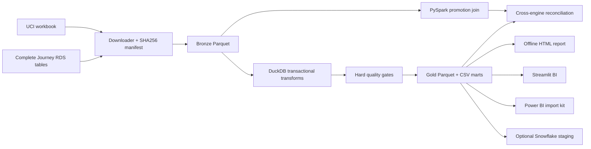

# Architecture and data contracts

DuckDB is the zero-service reference execution engine. Spark is used where scale and join mechanics are meaningful: the 20.9M-row promotion table. Snowflake is an optional serving destination, not an unnecessary requirement for reproducing the analysis.

## Grains

- `retail_classified`: source UCI line plus mutually exclusive disposition.
- `fact_lines`: retained positive, customer-attributed source line. Retail exact duplicates removed; grocery receipt lines preserved.
- `fact_orders`: source + customer key + order ID; timestamp is the first line time.
- `dim_customers`: source-scoped identity; first and last observed purchases, RFM.
- `mart_cohorts`: source + first-observed calendar month + age in months. Contains only observation-eligible cells; zero-filled inactive cells.
- `mart_monthly`: source + activity month, revenue split by first observed/returning cohort.
- `mart_repeat`: source, with a full 90-day follow-up denominator.
- `mart_segments`: source + RFM segment. Source-specific quintiles are relative, not universal behavioral thresholds; ties resolve by customer key.
- `mart_campaigns`: campaign ID, targeted and redeeming households; no fabricated cost or causal ROI.
- `mart_promotions`: week + promotion status. Basket counts are distinct within each group and **not additive across promotion statuses**.

## Temporal validity

The initial cohort includes pre-existing customers whose earlier activity is outside the data. “First observed” is not “acquired.” Final months are flagged incomplete using the final observed transaction date. BI excludes incomplete months by default for cohort comparison. This conservative rule can mark a genuinely complete month incomplete if no one purchased on its final day; source completeness cannot be proven from events alone.

Observed cumulative revenue/customer is not modeled lifetime value. Returns stay in the quality ledger and are excluded from positive-sales cohorts. No refund matching is invented. No CAC, gross margin, churn probability, or acquisition-channel attribution is fabricated.

## Reliability and limits

Downloads use temporary files and retry transient failures. Source files and bronze conversions are cached; manifests record hashes and row counts. SQL replacement occurs inside a transaction and rolls back on a failed gate. CSV/Parquet export is a separate step after the committed warehouse; an interrupted export should be rerun before serving. There is no claim of atomic multi-file publication, production scheduling, CDC, or enterprise access control.

Large tables stay outside Streamlit; only small marts are loaded. The local engine has a 2GB memory cap and four threads; RDS-to-Parquet conversion may use more memory. Spark partitions output by study week and uses adaptive execution. Full source records are never replicated to increase the benchmark size.

## Operational runbook

1. Ingest real sources. Inspect `data/manifest.json` for all expected tables.
2. Build; any failed quality gate aborts the transaction.
3. Generate report and Snowflake scripts after the successful build.
4. Run Spark and `scripts/verify_spark.py`; retain evidence.
5. Run tests and review report before sharing.
6. On source schema change, fail and update the explicit contract; never silently fill absent fields.
